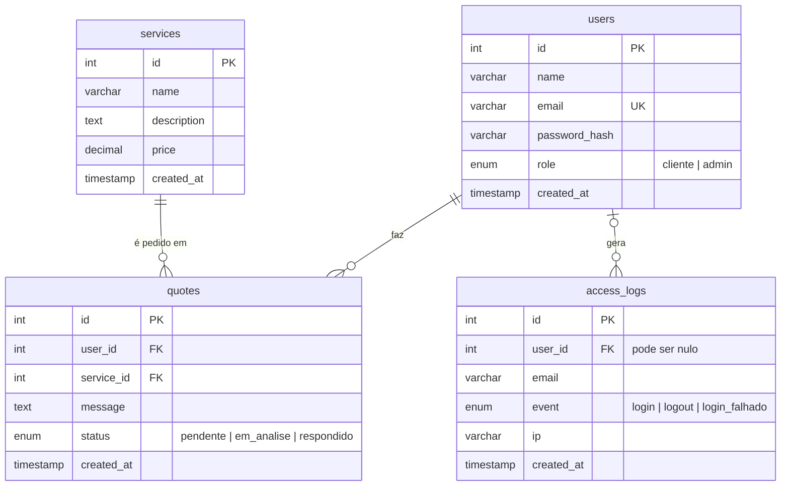

# Vértice TI — Aplicação Web de Consultoria

Atividade prática em dupla (BD — Bezerra): aplicação web de uma empresa de consultoria em Tecnologias de Informação, com front-end, back-end, base de dados MySQL e segurança.

> **Dupla:** _Nome do Sócio 1_ e _Nome do Sócio 2_ (preencher)
> **Link da aplicação publicada:** _não publicada / colocar aqui, se houver_

## Descrição

A empresa fictícia **Vértice TI** apresenta os seus serviços e sócios numa página inicial pública. Os clientes registam-se, consultam os serviços e submetem pedidos de orçamento. Os administradores gerem o catálogo de serviços (CRUD), consultam clientes e pedidos e acompanham o registo de acessos.

### Funcionalidades

| Área | O que faz |
|---|---|
| Página inicial | Empresa, logótipo, serviços e apresentação dos três sócios com currículo resumido |
| Cliente | Registo, início/encerramento de sessão, consulta de serviços, submissão e consulta de pedidos de orçamento |
| Administração (`/admin`) | CRUD completo de serviços, consulta de clientes e pedidos, registo de acessos com data e hora |
| Segurança | Senhas com bcrypt, validação de credenciais, rotas `/admin` protegidas, sessões seguras |

## Tecnologias

- **Front-end:** HTML, CSS e JavaScript (páginas geradas com EJS)
- **Back-end:** Node.js + Express
- **Base de dados:** MySQL (testado também em MariaDB/XAMPP), driver `mysql2`
- **Segurança:** `bcryptjs` (algoritmo bcrypt, custo 12), `express-session`, `helmet`, proteção CSRF, consultas parametrizadas

## Estrutura do projeto

```
consultoria-ti/
├── database/schema.sql        # criação da BD, tabelas e serviços iniciais
├── docs/screenshots/          # capturas de ecrã
├── public/                    # CSS, JS do navegador e logótipo
├── scripts/create-admin.js    # cria o utilizador administrador
├── src/
│   ├── server.js              # arranque, sessão, helmet, rotas
│   ├── config.js              # nome da empresa e dados dos sócios
│   ├── db.js                  # ligação ao MySQL
│   ├── middleware.js          # autenticação, admin e CSRF
│   ├── validators.js          # validação dos formulários
│   └── routes/                # public, auth, client, admin
├── views/                     # páginas EJS (+ views/admin)
├── .env.example               # modelo de configuração (sem credenciais)
└── package.json
```

## Modelo da base de dados



**Decisões de modelação**

- `users.email` é `UNIQUE`; `password_hash` guarda apenas o hash bcrypt, nunca a senha.
- `quotes` liga cliente e serviço (relação 1:N em cada lado). `user_id` usa `ON DELETE CASCADE`; `service_id` usa `ON DELETE RESTRICT`, por isso **não é possível eliminar um serviço que já tenha pedidos** (a aplicação mostra uma mensagem explicando).
- `access_logs.user_id` é `ON DELETE SET NULL`: o histórico de acessos sobrevive mesmo que o utilizador seja apagado. Também regista tentativas falhadas (com `user_id` nulo se o email não existir).
- Script completo: [`database/schema.sql`](database/schema.sql).

## Instalação e execução (passo a passo)

### Pré-requisitos
- [Node.js](https://nodejs.org) 18 ou superior
- XAMPP (MySQL/MariaDB) ou MySQL Server com MySQL Workbench

### 1. Clonar e instalar dependências
```bash
git clone <URL-DO-REPOSITORIO>
cd consultoria-ti
npm install
```

### 2. Criar a base de dados
Inicie o MySQL (no XAMPP: botão **Start** em MySQL) e execute `database/schema.sql`:
- **phpMyAdmin:** separador *Importar* e escolher `database/schema.sql`; ou
- **MySQL Workbench:** *File → Open SQL Script*, escolher o ficheiro e executar (⚡); ou
- **Terminal:** `mysql -u root -p < database/schema.sql`

### 3. Configurar o ambiente
Copie o modelo e edite-o:
```bash
cp .env.example .env        # Windows: copy .env.example .env
```
No `.env`:
1. `SESSION_SECRET`: gere um valor com `node -e "console.log(require('crypto').randomBytes(32).toString('hex'))"`.
2. `DB_USER` / `DB_PASSWORD`: no XAMPP, por defeito `root` e senha vazia.
3. `ADMIN_EMAIL` e `ADMIN_PASSWORD`: credenciais do administrador (mínimo 8 caracteres).

> O `.env` está no `.gitignore` e **nunca** deve ser enviado para o GitHub.

### 4. Criar o administrador
```bash
npm run create-admin
```
Depois, apague `ADMIN_PASSWORD` do `.env`.

### 5. Executar
```bash
npm start
```
Abra <http://localhost:3000>. A área administrativa está em <http://localhost:3000/admin>.

### Personalizar a empresa
Nome, slogan e dados dos sócios estão em `src/config.js`. Os serviços gerem-se em `/admin/servicos`.

## Segurança implementada

| Medida | Onde |
|---|---|
| Hash de senhas com **bcrypt** (custo 12), limite de 72 bytes validado | `src/routes/auth.js`, `src/validators.js` |
| Mensagem de erro genérica no login (não revela se o email existe) + hash falso para igualar o tempo | `src/routes/auth.js` |
| Rotas `/admin` protegidas no router inteiro (anónimo → login, cliente → 403) | `src/middleware.js`, `src/routes/admin.js` |
| `role` nunca vem do formulário; registo cria sempre `cliente` | `src/routes/auth.js` |
| Novo ID de sessão após o login (contra _session fixation_) | `src/routes/auth.js` |
| Cookie de sessão `HttpOnly`, `SameSite=Lax`, `Secure` em produção, expira em 2 h | `src/server.js` |
| Proteção **CSRF** em todos os POST, incluindo logout | `src/middleware.js` |
| Consultas SQL **parametrizadas** (contra SQL injection) | todas as rotas |
| Escape automático de HTML nas views (contra XSS) + cabeçalhos do Helmet/CSP | `views/`, `src/server.js` |
| Validação no servidor de todos os formulários | `src/validators.js` |
| Credenciais fora do repositório (`.env` ignorado) | `.gitignore`, `.env.example` |

### Limitações conhecidas
- As sessões ficam em memória (reiniciar o servidor termina todas as sessões). Para produção, usar um _session store_ persistente.
- Não há limite de tentativas de login (_rate limiting_); as tentativas falhadas ficam registadas em `access_logs`.
- Não há recuperação de senha por email.

## Capturas de ecrã

Guardar em `docs/screenshots/` e referenciar aqui:

| Funcionalidade | Ficheiro |
|---|---|
| Página inicial | `docs/screenshots/home.png` |
| Registo / login | `docs/screenshots/login.png` |
| Pedido de orçamento | `docs/screenshots/pedido.png` |
| Painel admin | `docs/screenshots/admin.png` |
| CRUD de serviços | `docs/screenshots/admin-servicos.png` |
| Registo de acessos | `docs/screenshots/admin-acessos.png` |

## Divisão de trabalho

| Sócio | Responsabilidades |
|---|---|
| _João Pedro Bastos_ | _Segurança, Infraestrutura e Bases de Dados_ |
| _Pedro Peterson_ | _Segurança, Infraestrutura e Bases de Dados_ |
| _Pablito_ | _Segurança, Infraestrutura e Bases de Dados_ |